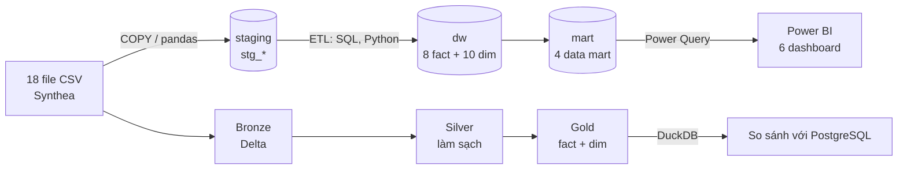

# Data Warehouse & BI trên dữ liệu y tế Synthea

Bài tập lớn môn **Kho dữ liệu và Kinh doanh thông minh**.
Xây dựng kho dữ liệu (Data Warehouse – DW) và hệ thống báo cáo thông minh (Business Intelligence – BI) trên dữ liệu y tế tổng hợp Synthea, bang Massachusetts, giai đoạn 2023–2025. Chủ đề mở rộng: **Data Lakehouse**.

> Repo này chỉ chứa **code**. Dữ liệu CSV, file Power BI (.pbix), báo cáo và slide lưu trên Google Drive của nhóm: https://drive.google.com/drive/u/0/folders/1UYBstJ9JB-LLHR31A_CIA9IepMeM6GgQ

---

## 1. Thông tin chung

| Mục | Nội dung |
|---|---|
| Tổ chức giả định | Mạng lưới cơ sở y tế tại Massachusetts |
| Dữ liệu | Synthea – 18 file CSV, toàn bang Massachusetts, 01/2023 – 12/2025 |
| Hệ quản trị CSDL | PostgreSQL (3 schema: `staging`, `dw`, `mart`) |
| Lược đồ DW | Galaxy Schema (Fact Constellation): 8 fact + 10 dimension |
| BI | Power BI Desktop / Service – 6 dashboard |
| Lakehouse | Delta Lake (thư viện `deltalake`) + DuckDB; Microsoft Fabric là tùy chọn |
| Thời gian | 04/11/2026 – 11/11/2026 (4 sprint × 2 ngày) |

## 2. Thành viên

| Mã | Thành viên | Vai trò | Phần code phụ trách |
|---|---|---|---|
| TV1 | Phước | Nhóm trưởng; khảo sát nghiệp vụ, KPI; dashboard D2, D5 | DAX cho D2, D5 |
| TV2 | Lộc | Kỹ sư dữ liệu | `sql/`, `python/` (nạp dữ liệu, ETL), `lakehouse/` |
| TV3 | Sơn | Phân tích dữ liệu & mô hình hóa | `python/` (EDA), dashboard D4, D6 |
| TV4 | Xuân | BI & lý thuyết | `r/`, `powerquery/`, DAX, dashboard D1, D3 |

## 3. Kiến trúc hệ thống



Luồng chính: **Nguồn → Staging → Data Warehouse → Data mart → BI**.
Luồng mở rộng (Lakehouse): **Bronze → Silver → Gold**. Gold phải khớp số liệu với DW trên PostgreSQL.

## 4. Thiết kế kho dữ liệu

### 4.1. Bảng fact

| Fact | Grain (mỗi dòng là) | Measure chính |
|---|---|---|
| `fact_encounter` | 1 lượt khám | số lượt, chi phí gốc, tổng chi phí, BH trả, bệnh nhân trả*, thời lượng*, tái nhập viện 30 ngày* |
| `fact_claim` | 1 hồ sơ thanh toán | số claim, công nợ BH chính / BH phụ / bệnh nhân |
| `fact_claim_transaction` | 1 giao dịch thanh toán | phí, thực thu, điều chỉnh, chuyển nợ, còn nợ |
| `fact_condition` | 1 chẩn đoán | số ca mới, số bệnh nhân, số ngày mắc* |
| `fact_medication` | 1 đơn thuốc | số đơn, số lần cấp, đơn giá, BH trả, tổng tiền |
| `fact_procedure` | 1 thủ thuật | số thủ thuật, giá |
| `fact_immunization` | 1 mũi tiêm | số mũi, giá |
| `fact_observation` | 1 lần đo / xét nghiệm | số lần đo, giá trị số |

\* Cột dẫn xuất, tính trong bước ETL.

### 4.2. Bảng dimension

| Dimension | Thuộc tính chính | Phân cấp |
|---|---|---|
| `dim_date` | ngày, tháng, quý, năm, thứ, tuần, mùa | năm → quý → tháng → ngày |
| `dim_patient` | giới tính, nhóm tuổi, chủng tộc, dân tộc, hôn nhân, nhóm thu nhập | |
| `dim_geography` | bang, hạt (county), thành phố, ZIP | bang → hạt → thành phố |
| `dim_facility` | loại cơ sở*, tên cơ sở, tọa độ | |
| `dim_provider` | chuyên khoa*, giới tính | |
| `dim_encounter_type` | loại lượt khám, môi trường chăm sóc, mã lượt khám | loại → mã |
| `dim_payer` | tên hãng bảo hiểm, loại sở hữu, chủ gói | dùng 2 vai trò: BH chính, BH phụ |
| `dim_payment` | loại giao dịch, phương thức, trạng thái claim, chuyển nợ | junk dimension |
| `dim_clinical` | nhóm chỉ số đo | |
| `dim_code` | lĩnh vực mã, nhóm lâm sàng*, mã | lĩnh vực → nhóm lâm sàng → mã |

\* **Thuộc tính dẫn xuất do nhóm tự tạo theo quy tắc** (bảng `specialty_rules`, `code_groups`), không có sẵn trong dữ liệu Synthea.

### 4.3. Data mart và dashboard

| Data mart | Phục vụ dashboard |
|---|---|
| `mart_operations` | D1 Tổng quan điều hành, D3 Vận hành |
| `mart_finance` | D2 Tài chính & bảo hiểm |
| `mart_clinical` | D4 Lâm sàng & dịch tễ (OLAP), D5 Thống kê – dự báo & kế hoạch – thực tế |
| `mart_geo` | D6 Địa lý y tế (bản đồ) |

## 5. Quy mô dữ liệu

Số liệu chính thức lấy từ tab **Số liệu chốt** trong file kế hoạch (nguồn duy nhất cho báo cáo, slide, dashboard).

| Chỉ số | Giá trị |
|---|---|
| Số file CSV nguồn | 18 |
| Tổng dung lượng nguồn | [__] MB |
| Số bệnh nhân | [__] |
| Số lượt khám | [__] |
| Tổng số dòng 8 fact | [__] |
| Thời gian nạp `claims_transactions` (COPY / pandas) | [__] giây / [__] giây |

## 6. Cấu trúc thư mục

```
btl-dw-bi-synthea/
├── README.md
├── sql/            # Tạo schema, staging, ETL, dim, fact, mart, index, đo hiệu năng
├── python/         # Nạp CSV vào staging; EDA; ETL bằng pandas
├── r/              # EDA bằng R
├── powerquery/     # Code Power Query (M) và DAX lưu dạng text
└── lakehouse/      # Bronze – Silver – Gold; truy vấn DuckDB; so sánh với PostgreSQL
```

Đặt tên file code có số thứ tự theo thứ tự chạy, ví dụ: `sql/01_tao_schema.sql`, `sql/02_tao_staging.sql`, `python/01_nap_staging.py`.

## 7. Cách chạy lại từ đầu

> Mục này cập nhật dần khi có script. Mọi script phải chạy lại được từ đầu và có chú thích tiếng Việt.

**Yêu cầu cài đặt:** PostgreSQL ≥ 16, Python ≥ 3.10, R, Power BI Desktop.

```bash
# 1. Tải code
git clone [__ link repo __]
cd btl-dw-bi-synthea

# 2. Cài thư viện Python
pip install pandas sqlalchemy psycopg2-binary deltalake duckdb

# 3. Tải 18 file CSV từ Google Drive, đặt vào thư mục data/ (thư mục này không đưa lên Git)
```

| Bước | Việc | Script | Mã việc |
|---|---|---|---|
| 1 | Tạo database `synthea_dw` và 3 schema | `sql/01_tao_schema.sql` [__] | S1.02 |
| 2 | Nạp 18 CSV vào `staging` | [__] | S1.03 |
| 3 | ETL: tạo dim và fact trong `dw` | [__] | Sprint 2 |
| 4 | Tạo 4 data mart trong `mart` | [__] | Sprint 2 |
| 5 | Mở file .pbix trên Drive, đổi kết nối sang PostgreSQL máy mình, bấm Refresh | — | Sprint 3 |
| 6 | Chạy Lakehouse Bronze → Silver → Gold | [__] | Sprint 3–4 |

## 8. Quy tắc và giả định của nhóm

- **Bệnh mãn tính:** `STOP` trống hoặc kéo dài ≥ 365 ngày (giả định của nhóm).
- **Chẩn đoán:** `conditions` có cả mục không phải bệnh; phân tích "bệnh" chỉ lấy nhãn `(disorder)`.
- **Giao dịch thanh toán** theo cột `TYPE`: CHARGE lấy `AMOUNT`; PAYMENT lấy `PAYMENTS`; TRANSFERIN / TRANSFEROUT lấy `TRANSFERS`.
- **Hạt đảo** Nantucket, Dukes ít bệnh nhân: luôn hiển thị kèm số bệnh nhân hoặc gộp thành "Hạt đảo".
- **Ngưỡng cảnh báo KPI và chỉ tiêu kế hoạch** là đề xuất của nhóm, không có trong dữ liệu Synthea.
- **Giá trị phân loại:** giữ mã gốc tiếng Anh, thêm cột nhãn tiếng Việt.

## 9. Lưu ý khi xử lý dữ liệu

- **Không mở rồi lưu lại CSV bằng Excel:** Excel cắt bảng trên ~1 triệu dòng, làm mất số 0 đầu ZIP và đổi định dạng ngày.
- File CSV có ký tự **BOM** ở đầu: với pandas dùng `encoding='utf-8-sig'`; với `COPY` kiểm tra tên cột đầu không bị dính ký tự lạ (ví dụ `Id`).
- ZIP có giá trị `00000` (không xác định) và dạng 9 số (ZIP+4): chuẩn hóa về 5 số trong ETL.
- Đọc mọi cột dạng chuỗi ở bước staging, ép kiểu ở bước ETL.

## 10. Quy ước làm việc với Git

- **Không đưa dữ liệu lên Git** (CSV, Parquet, Delta, .pbix đã chặn trong `.gitignore`). GitHub từ chối file trên 100MB.
- Trước khi sửa: **Pull** để lấy code mới nhất. Sửa xong: **Commit** rồi **Push**.
- Tên commit kèm mã việc: `S2.05 ETL dim_patient`, `S3.01 thêm index fact_encounter`.
- Tên trong CSDL: tiền tố `stg_`, `dim_`, `fact_`, `mart_`; viết thường, nối bằng gạch dưới.
- Mỗi script có chú thích tiếng Việt ở đầu file: mục đích, input, output, người viết, mã việc.

Mẫu đầu file SQL:

```sql
-- Mục đích : Tạo bảng dim_patient từ staging.stg_patients
-- Input    : staging.stg_patients
-- Output   : dw.dim_patient
-- Người viết: TV2 | Mã việc: S2.05
```
